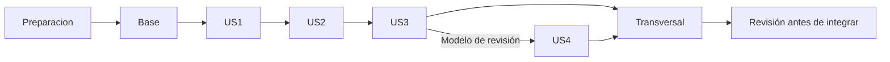

# Tareas: asistencia con QR dinámico, invitados y geolocalización opcional

**Funcionalidad**: `001-asistencia-qr-dinamico` · **Fecha**: 2026-10-19 · **Estado**: implementación en curso; 88 de 93 tareas completadas; cinco tareas conservan validaciones externas pendientes.
**Fuentes**: [spec.md](spec.md), [plan.md](plan.md), [research.md](research.md), [data-model.md](data-model.md), [OpenAPI](contracts/openapi.yaml) y [quickstart.md](quickstart.md).

Este desglose sustituye las 44 tareas iniciales. Las marcas actuales representan implementación y verificación registradas en la evidencia final; no conceden aprobación constitucional. La excepción del flujo invitado por cédula/listado sigue pendiente de revisión real en [ADR 0002](../../docs/adr/0002-identificacion-invitados.md), con integración condicionada por la gobernanza. Las tareas documentan el flujo pedido; no añaden verificación presencial ni códigos personales.

Las pruebas se incluyen por los criterios SC de la especificación y el principio XII de la constitución. Escribirlas y comprobar su fallo por comportamiento ausente antes de implementar cada historia; el incremento termina al pasar sus pruebas, no al crear archivos. PostgreSQL real es obligatorio para unicidad, transacciones y carreras.

**Formato**: `- [ ] T### [P] [USn] Descripción con ruta`. `[USn]` solo aparece en historias; `[P]` permite trabajo simultáneo exclusivamente con sus prerrequisitos satisfechos y archivos distintos. Las rutas identifican implementación y evidencia. No se modifica la checklist de revisión humana.

**Vocabulario**: responsable es una relación con la actividad y un permiso efectivo docente/encargado; no es un rol global. Actividad y sesión tienen cierres distintos. Los cinco años son calendario desde cierre definitivo de actividad. El tiempo de invitado pertenece únicamente al formulario ya abierto; QR y cuentas conservan 40 s. GPS OFF funciona sin PostGIS.

## Fase 1: Preparación

**Objetivo**: Crear los tres proyectos, fijar herramientas y hacer explícitas las condiciones de integración.

- [X] T001 Preparar el registro de revisión del plan y de la desviación de identidad en `docs/adr/0002-identificacion-invitados.md` y `docs/adr/0001-arquitectura-y-contrato.md`; mantener estado pendiente hasta contar con evidencia real de otro integrante y bloquear integración sin esa aprobación. No añadir OTP ni validación presencial descartados por el usuario, ni modificar la constitución. La preparación técnica reversible puede continuar; esta tarea no concede aprobación humana.
- [X] T002 Inicializar Java 21 y Spring Boot 4.1.x MVC/Security/Data JPA con Maven Wrapper en `services/api/pom.xml`, `services/api/mvnw` y `services/api/.mvn/wrapper/maven-wrapper.properties`; fijar parches compatibles, Flyway, PostgreSQL, JUnit Jupiter 6 y Testcontainers 2 desde el BOM, sin H2; separar paquetes por dominio y capas de `plan.md`.
- [X] T003 [P] Inicializar Next.js 16.x/React 19.2 y TypeScript estricto en `apps/web/package.json` y `apps/web/tsconfig.json`; fijar parche y lockfile, comandos explícitos de build, lint, tipos, componentes y recorrido Playwright; no usar el build como sustituto del linter.
- [X] T004 [P] Inicializar Expo SDK 57/React Native 0.86/React 19.2.3 según su matriz en `apps/mobile/package.json`, `apps/mobile/app.config.ts` y `apps/mobile/tsconfig.json`; fijar lockfile, cámara, SecureStore y pruebas de componentes; declarar Android/iOS y TypeScript estricto.
- [X] T005 Crear PostgreSQL 17 y perfil API de desarrollo en `infra/docker-compose.yml`, `.env.example` y `services/api/src/main/resources/application.yml`; separar credenciales locales, configurar UTC y arranque base sin extensión PostGIS ni servicio CAS supuesto.
- [X] T006 Fijar Node 22 LTS >=22.13 en `.node-version`, reglas Java/TS y exclusión de secretos en `services/api/pom.xml`, `apps/web/eslint.config.mjs`, `apps/mobile/eslint.config.mjs` y `.gitignore`; documentar un único gestor por cliente y confirmar sus lockfiles.
- [X] T007 Añadir validación real OpenAPI 3.0.3 y generación/verificación de tipos de ambos clientes en `tools/contracts/package.json` y `tools/contracts/validate.mjs` usando `specs/001-asistencia-qr-dinamico/contracts/openapi.yaml`; fijar versiones/lockfile y rechazar refs, ejemplos o esquemas inválidos, sin inventar operaciones adicionales.
- [X] T008 Crear `.github/workflows/ci.yml` con Java/Node fijados y trabajos de API, PostgreSQL, contrato, lint/tipos y clientes usando los comandos anteriores; no registrar suites vacías como evidencia de funcionalidad ni publicar secretos.

## Fase 2: Base compartida

**Objetivo**: Disponer de identidad, permisos, persistencia, reloj, respuestas y herramientas de prueba antes de construir las historias.

- [X] T009 Crear `services/api/src/main/resources/db/migration/V001__identidades_y_ambito.sql` y entidades de `services/api/src/main/java/ec/edu/unl/geoasist/identidades/persistencia/` para personas, cuentas, roles, carreras, paralelos y direcciones; citar y aplicar: "Cédula funcional de diez dígitos; no acredita titularidad. No se exponen datos por consulta pública de cédula."; `cedula_normalizada` única como texto ASCII `^[0-9]{10}$`, `persona_id` único FK, identificador de acceso único y "hash de contraseña local nullable"; "Persona puede existir sin cuenta. Cualquier cuenta existente, incluso inactiva, impide vía invitada. Credencial local solo en perfil de desarrollo."; roles `DOCENTE`, `ENCARGADO`, `ESTUDIANTE`, `DIRECTOR_INSTITUCIONAL`, `DIRECTOR_CARRERA`, vigencia de dirección, "Datos semilla en este incremento; no se presume sincronización académica real." y "Carrera del paralelo consistente con los vínculos de la actividad."
- [X] T010 Crear `services/api/src/main/resources/db/migration/V002__actividades_y_sesiones.sql` y entidades de `services/api/src/main/java/ec/edu/unl/geoasist/actividades/persistencia/` y `services/api/src/main/java/ec/edu/unl/geoasist/sesiones/persistencia/`; aplicar "Tiempos `timestamptz` en UTC; IDs UUID salvo códigos de configuración.", modalidad `CLASE/EVENTO`, actividad `ABIERTA/CERRADA`, sesión `PROGRAMADA/ACTIVA/CERRADA`, responsable cuenta FK, carreras/paralelos explícitos, autorización única clase/persona con vigencia, espacio FK y ventana inicio/fin coherente. Aplicar "Eventos multicarrera requieren asociación explícita; pertenecer a una carrera no implica acceso a todas.", "Un estudiante autenticado necesita vínculo vigente con la clase. No puede usar flujo invitado para eludirlo.", "Centro/radio solo en configuración geográfica opcional. Sin GPS no se exige dato espacial para registrar." y "Cierre definitivo inmutable. `anonimizar_en` = cierre + cinco años calendario. Actividad cerrada no admite nuevas sesiones ni registros." y "Activar/cerrar solo responsable. No reabrir una sesión cerrada para revivir QR o formularios." (FR-001, FR-016, FR-021, FR-022, FR-024).
- [X] T011 Crear `services/api/src/main/resources/db/migration/V003__acceso_idempotencia_auditoria.sql` y adaptadores base en `services/api/src/main/java/ec/edu/unl/geoasist/identidades/persistencia/` y `services/api/src/main/java/ec/edu/unl/geoasist/actividades/persistencia/`; para `sesiones_acceso` aplicar "Secreto opaco; no guardar valor original, no mezclar con inicio de invitado." con hash único y creada/vencimiento/revocación; `idempotencias` con clave UUID, actor/operación/huella HMAC y resultado mínimo: "Único operación/actor/clave. Otra carga con misma clave da 409. No conservar el cuerpo original con cédula/coordenadas ni secretos. TTL técnico inicial 24 h y retirada al anonimizar antes si corresponde."; `contadores_limite`: "Efímeros y separados de auditoría; no guardar IP cruda como historial de cinco años."; auditoría FK de actividad/actor, acción, instante, correlación, razón y diferencias mínimas (FR-009, FR-014, FR-023).
- [X] T012 Crear contenedor PostgreSQL real, reloj sustituible y fixtures de dos carreras, dos responsables, directores, clase/evento y cuentas activas/inactivas en `services/api/src/test/java/ec/edu/unl/geoasist/soporte/PostgresFixture.java` y `services/api/src/test/java/ec/edu/unl/geoasist/soporte/ScenarioFixtures.java`; ejecutar migraciones reales y aislar datos por prueba, sin sustituir bloqueos por mocks.
- [X] T013 [P] Escribir pruebas de contrato `login`/`logout`, token expirado/revocado y proveedor local solo desarrollo en `services/api/src/test/java/ec/edu/unl/geoasist/identidades/AuthContractTest.java`; comprobar secretos ausentes de respuestas posteriores/logs, 401 y revocación efectiva.
- [X] T014 [P] Escribir matriz de permisos efectivos en `services/api/src/test/java/ec/edu/unl/geoasist/actividades/ActivityScopeTest.java`: responsabilidad más rol docente/encargado para escritura/exportación, director institucional lectura global, director de carrera solo vínculos vigentes del servidor y paralelos; filtros del cliente no amplían acceso, multirrol no pierde responsabilidad y rol director solo no modifica/exporta (FR-004, FR-021, SC-011).
- [X] T015 Implementar reloj UTC inyectable, captura `recibido_en` al ingreso y generación aleatoria/hash de secretos en `services/api/src/main/java/ec/edu/unl/geoasist/compartido/aplicacion/ServerTime.java` y `services/api/src/main/java/ec/edu/unl/geoasist/compartido/aplicacion/OpaqueSecrets.java`; usar 32 bytes para QR, no reloj del dispositivo ni secretos originales persistidos (FR-002, FR-003).
- [X] T016 Implementar política común de conservación y guardia previa a TODA lectura/exportación nominal en `services/api/src/main/java/ec/edu/unl/geoasist/compartido/dominio/RetentionPolicy.java` y `services/api/src/main/java/ec/edu/unl/geoasist/compartido/aplicacion/NominalAccessGuard.java`: cinco años calendario desde cierre definitivo, aniversario 29/02 a 28/02 UTC, sesión cerrada no inicia plazo; 410 si recurso vencido reconocible y 404 tras retirar encabezado, incluso si el lote falla (FR-022, FR-025, SC-013).
- [X] T017 Implementar proveedor por puerto, credenciales ficticias solo desarrollo, bearer opaco revocable con hash PostgreSQL y `login`/`logout` en `services/api/src/main/java/ec/edu/unl/geoasist/identidades/aplicacion/AuthenticationService.java`, `services/api/src/main/java/ec/edu/unl/geoasist/identidades/presentacion/AuthController.java` y `services/api/src/main/java/ec/edu/unl/geoasist/identidades/presentacion/ApiSecurityConfig.java`; rutas privadas por defecto, públicas solo login/apertura/envío invitado, contraseña nunca en logs y CAS real pendiente (FR-006, FR-017).
- [X] T018 Implementar predicados de lectura, responsabilidad, modificación y exportación en `services/api/src/main/java/ec/edu/unl/geoasist/actividades/aplicacion/ActivityAuthorization.java`; usar carreras/paralelos y dirección vigentes del servidor, reusar guardia de vencimiento y evitar ampliación por IDs o filtros arbitrarios; "Poseer un rol no crea automáticamente vínculo de responsabilidad ni facultades de exportación." y "Solo fuentes del servidor deciden qué carrera dirige una cuenta; petición no puede asignársela." (FR-004, FR-021).
- [X] T019 Implementar Problem Details, correlación, `Cache-Control: no-store` y logs redactados en `services/api/src/main/java/ec/edu/unl/geoasist/identidades/presentacion/ApiProblemHandler.java` y `services/api/src/main/resources/logback-spring.xml`; respetar `code`/`mensaje`, campos requeridos y estados del YAML; nunca registrar cuerpos con cédulas, IP cruda, QR, bearer, inicio invitado o coordenadas (FR-010, SC-005).
- [X] T020 Implementar escritor transaccional en `services/api/src/main/java/ec/edu/unl/geoasist/actividades/aplicacion/ActivityAuditWriter.java`: "Incluye configuración, listado, cierres, exportación y revisión. No copiar secretos, listados enteros, contraseñas ni ubicación cruda. Solo lectores dentro del ámbito de esa actividad."; append-only durante retención nominal, actor/actividad/instante/acción y razón/antes/nuevo cuando corresponda; no es conservación indefinida (FR-023, SC-012).
- [X] T021 Implementar autorización previa a replay, huella HMAC canónica, recibo mínimo y exclusión transaccional por operación/actor/UUID en `services/api/src/main/java/ec/edu/unl/geoasist/compartido/aplicacion/IdempotencyService.java`; validar `Idempotency-Key` requerido por contrato, replay idéntico sin nueva asistencia, payload distinto 409 y limpieza 24 h o antes por anonimización (FR-009, FR-011).
- [X] T022 Implementar contadores PostgreSQL de ventana y claves HMAC efímeras por ámbito en `services/api/src/main/java/ec/edu/unl/geoasist/identidades/aplicacion/RequestBudget.java`; 429 con `Retry-After`, caducidad/limpieza y presupuesto de autenticación de laboratorio 5/min identidad y 300/min IP, sin IP cruda ni Redis obligatorio (FR-014).
- [X] T023 Crear semillas deterministas ficticias para cuenta, roles, carreras, paralelos, actividades y sesiones programadas en `services/api/src/main/resources/db/dev/seed.sql` y documentar inyección de credenciales en `infra/README.md`; no implementar CRUD académico fuera del contrato ni asumir sincronización UNL (FR-016, FR-017, FR-021).
- [X] T024 [P] Crear cliente API tipado con bearer SOLO en memoria, cierre/expiración de sesión y recepción de errores en `apps/web/src/lib/api/client.ts` y `apps/web/src/features/auth/SessionProvider.tsx`, `apps/web/src/features/auth/LoginForm.tsx` y `apps/web/src/features/auth/LoginForm.test.tsx`; incluir formulario de credenciales ficticias con errores/logout y enrutamiento Next hacia paneles, probar login/expiración/revocación; tipos desde YAML, no localStorage/sessionStorage de autenticación, no telemetría de cuerpos sensibles (FR-006, SC-005).
- [X] T025 [P] Crear cliente API tipado, sesión de cuenta en SecureStore, revocación/logout y errores en `apps/mobile/src/services/api.ts` y `apps/mobile/src/features/auth/session.ts`, `apps/mobile/src/features/auth/LoginScreen.tsx` y `apps/mobile/src/features/auth/LoginScreen.test.tsx`; incluir credenciales ficticias, errores/logout y callback de sesión para el escáner de T057, probar login/expiración/revocación; diferenciar secreto de cuenta de inicio invitado y usar HTTPS fuera del entorno local (FR-006, SC-005).

## Fase 3: US1 — Abrir una sesión con QR dinámico (P1)

**Objetivo**: Permitir al responsable elegir actividad, configurar invitados, iniciar/cerrar sesiones y realizar cierre definitivo.

**Prueba independiente**: Con semillas y reloj controlado, el responsable configura un evento, inicia sesión y obtiene QR compartido que rota a los 30 s y vence a los 40 s; otro responsable no puede actuar. Cerrar sesión revoca QR/formularios; cerrar actividad cierra todas sus sesiones y fija una sola fecha de conservación. Se prueba sin registrar asistentes ni habilitar GPS.

### Pruebas antes de implementación

- [X] T026 [P] [US1] Escribir pruebas de contrato de `listActivities`, `getActivity`, `startSession`, `closeSession`, `getSessionQr`, `closeActivity` en `services/api/src/test/java/ec/edu/unl/geoasist/sesiones/SessionContractTest.java`; cubrir bearer ausente, rol/ámbito denegado, estado incompatible, idempotencia, ventana y respuesta sin secretos ajenos (FR-001, FR-004, FR-011, FR-021, FR-024).
- [X] T027 [P] [US1] Escribir pruebas de contrato de `setGuestSettings` y `replaceGuestList` en `services/api/src/test/java/ec/edu/unl/geoasist/actividades/GuestConfigurationContractTest.java`: evento propio, entero mínimo 41, requerido al habilitar, lista JSON hasta 1000, nombres 1..200, cédulas ASCII con ceros, repetidas o filas inválidas rechazan lote completo con errores por índice, cuenta no se convierte en invitada (FR-018, FR-019, FR-020).
- [X] T028 [P] [US1] Escribir reglas temporales con reloj controlado en `services/api/src/test/java/ec/edu/unl/geoasist/qr/QrLifecycleTest.java`: 30 s rotación, 39 s vigente, 40 s vencido, solapamiento válido, QR compartido no consumible, límites de ventana y cierre; solo referencia opaca, sin PII (FR-002, FR-003, FR-011, SC-004).
- [X] T029 [P] [US1] Escribir integración PostgreSQL de cierre definitivo frente a inicio/cierre sesión en `services/api/src/test/java/ec/edu/unl/geoasist/actividades/ActivityClosureTest.java`: serialización y rollback total, sin reapertura, fecha inmutable, cinco años calendario y 29/02, cierre de sesión distinto de actividad (FR-024, FR-022, SC-013).

### Implementación

- [X] T030 [US1] Crear `services/api/src/main/resources/db/migration/V004__invitados_y_qr.sql` y entidades en `services/api/src/main/java/ec/edu/unl/geoasist/actividades/persistencia/` y `services/api/src/main/java/ec/edu/unl/geoasist/qr/persistencia/`; configuración única actividad de EVENTO, versión y "Duración entera >40 requerida al habilitar. No es configuración del QR ni de usuarios con cuenta."; invitados con nombres precargados, activo, cargado por/fecha/versión, "Único actividad/persona. Cargar lista no convierte una persona con cuenta en invitada. Reemplazo atómico y auditado."; QR hash único, emitido/expira y "Secreto aleatorio de 32 bytes; expira emisión +40 s, rotación cada 30 s. Sirve a muchos participantes; no se consume al primer uso." (FR-002, FR-018, FR-020).
- [X] T031 [US1] Implementar repositorio de bloqueos en `services/api/src/main/java/ec/edu/unl/geoasist/compartido/persistencia/AttendanceLocks.java` y coordinación de alta/vinculación de cuenta en `services/api/src/main/java/ec/edu/unl/geoasist/identidades/aplicacion/AccountAssociationService.java`: actividad compartida → sesión exclusiva → persona exclusiva → inicio exclusivo; cierre actividad/listado usan actividad exclusiva, sesiones en orden; alta de cuenta usa misma persona sin orden inverso ni llamadas remotas dentro de transacción (FR-009, FR-011, FR-019, FR-024).
- [X] T032 [US1] Implementar configuración invitada y reemplazo completo del listado en `services/api/src/main/java/ec/edu/unl/geoasist/actividades/aplicacion/ConfigureGuests.java` y `services/api/src/main/java/ec/edu/unl/geoasist/actividades/aplicacion/ReplaceGuestList.java`; min41 sin valor obligatorio por defecto, habilitación solo EVENTO, recortar espacios exteriores de cédula como texto, `^[0-9]{10}$`, nombres min1/max200, `maxItems: 1000`, sin duplicadas, validación por índice, carga atómica bajo bloqueo exclusivo, auditada sin copia íntegra (FR-018, FR-019, FR-020).
- [X] T033 [US1] Implementar start/close de sesión y close definitivo de actividad en `services/api/src/main/java/ec/edu/unl/geoasist/sesiones/aplicacion/SessionLifecycle.java` y `services/api/src/main/java/ec/edu/unl/geoasist/actividades/aplicacion/CloseActivity.java`; comprobar responsabilidad, estado/ventana, conservar timestamps inmutables, invalidar capacidad de registrar por cierre y calcular anonimizar_en; aplicar idempotencia/auditoría en la misma transacción (FR-001, FR-011, FR-024).
- [X] T034 [US1] Implementar emisión/rotación concurrente y consulta de QR en `services/api/src/main/java/ec/edu/unl/geoasist/qr/aplicacion/IssueSessionQr.java`; persistir solo hash y mantener el valor renderizable en memoria temporal, 32 bytes aleatorios, renovar cada 30 s, expirar emisión +40 s y comparar con recibido_en, conservar solapamiento hasta expiración, no invalidar por primer escaneo; cerrar sesión/actividad prevalece (FR-002, FR-003, SC-004).
- [X] T035 [US1] Implementar `listActivities` y `getActivity` en `services/api/src/main/java/ec/edu/unl/geoasist/actividades/presentacion/ActivityQueryController.java` y `services/api/src/main/java/ec/edu/unl/geoasist/actividades/aplicacion/FindVisibleActivities.java`; paginación y filtros de modalidad/carrera acotados por autorización efectiva y vencimiento, actividad con responsable/carreras/paralelos desde relaciones reales (FR-004, FR-021).
- [X] T036 [US1] Implementar `startSession`, `closeSession`, `getSessionQr`, `closeActivity` en `services/api/src/main/java/ec/edu/unl/geoasist/sesiones/presentacion/SessionController.java`, `services/api/src/main/java/ec/edu/unl/geoasist/qr/presentacion/QrController.java` y `services/api/src/main/java/ec/edu/unl/geoasist/actividades/presentacion/ActivityCommandController.java`; usar DTOs/headers/respuestas exactas del YAML y operaciones idempotentes, sin emitir QR a lectores de dirección por su rol solo (FR-001, FR-004, FR-011, FR-024).
- [X] T037 [US1] Implementar `setGuestSettings` y `replaceGuestList` en `services/api/src/main/java/ec/edu/unl/geoasist/actividades/presentacion/GuestManagementController.java`; prohibir clase/director sin responsabilidad, validar `additionalProperties: false`, rechazar payload/lote inválido sin cambios parciales y retornar solo resultado acordado (FR-018, FR-020, FR-021).
- [X] T038 [US1] Crear selector de actividad y sesión preconfigurada por ID documentado en semillas, QR con actualización temporal, configurar tolerancia/listado y cierres con estado/motivo en `apps/web/src/features/sessions/ResponsibleSessionPanel.tsx` y `apps/web/src/features/activities/GuestSettingsPanel.tsx`; sin inventar un endpoint de descubrimiento de sesiones no previsto en el contrato; lista vía JSON, mostrar errores por fila, no fijar dos/cinco minutos, URL QR con `#qr=token` sin PII ni query/path (FR-001, FR-003, FR-018, FR-020, FR-024, SC-005).
- [X] T039 [US1] Crear y ejecutar recorrido de responsable contra API/PostgreSQL en `apps/web/e2e/session-lifecycle.spec.ts`: configurar evento, QR rotatorio, denegar ajeno, cierre de sesión y definitivo con fecha preservada; ejecutar T026, T027, T028 y T029, registrar evidencia en `specs/001-asistencia-qr-dinamico/quickstart.md`.

**Punto de control**: ejecutar las suites de esta historia y la regresión previa; demostrar su prueba independiente con fixtures. No requiere que una historia posterior esté implementada.

## Fase 4: US2 — Registrar asistencia con cuenta o como invitado (P1)

**Objetivo**: Completar asistencia con credenciales y autorización de clase/evento o con cédula de invitado precargado sin cuenta; mantener tiempos separados.

**Prueba independiente**: Con actividad/sesión sembradas, cuenta autorizada registra una vez; cuenta fuera de clase se rechaza. Invitado sin cuenta y en lista introduce solo cédula antes del límite propio; cuenta incluso inactiva o cédula fuera de lista se rechazan. Recargar no amplía el plazo y GPS OFF no pide ubicación. Cien ejecuciones de cien solicitudes simultáneas producen una sola asistencia por ejecución.

### Pruebas antes de implementación

- [X] T040 [P] [US2] Escribir pruebas de contrato para `recordAuthenticatedAttendance`, `startGuestRegistration`, `submitGuestAttendance` en `services/api/src/test/java/ec/edu/unl/geoasist/asistencia/AttendanceContractTest.java`; body/headers, 201/200/202 y errores del YAML, Idempotency-Key excepto apertura, no nombres del invitado en entrada/salida, bearer obligatorio solo vía autenticada, estado y motivo siempre (FR-005, FR-006, FR-010, FR-018, SC-005).
- [X] T041 [P] [US2] Escribir matriz de clase/evento, cuenta inactiva y lista específica en `services/api/src/test/java/ec/edu/unl/geoasist/asistencia/ParticipantEligibilityTest.java`: autenticado y autorizado en clase, invitado imposible en clase, evento con cuenta usa credenciales, sin cuenta en lista permitido, fuera de lista rechazado, sin autorregistro/nombres/cuenta nueva (FR-016, FR-017, FR-018, FR-019, SC-008, SC-009).
- [X] T042 [P] [US2] Escribir límites del formulario en `services/api/src/test/java/ec/edu/unl/geoasist/asistencia/GuestDeadlineTest.java`: T=41 y varios T>40, antes y exactamente inicio+T, QR vencido al abrir, QR rotado/vencido tras apertura, cambio de T, recarga/reloj alterado, cierre/deshabilitación, dos cédulas sobre un inicio; reintentos no prolongan ni crean otra asistencia (FR-020, FR-011, SC-004, SC-010).
- [X] T043 [P] [US2] Escribir integración PostgreSQL en `services/api/src/test/java/ec/edu/unl/geoasist/asistencia/AttendanceConcurrencyTest.java`: cien ejecuciones independientes de cien solicitudes simultáneas para misma persona/sesión, dos inicios, duplicados por vías competidoras, replay/payload distinto, carreras con cierre sesión/actividad, retirada de lista y alta de cuenta; comprobar una asistencia/consumo coherente sin continuar transacción abortada por unicidad (FR-009, FR-011, FR-019, FR-020, SC-003).
- [X] T044 [P] [US2] Escribir integración API/PostgreSQL en `services/api/src/test/java/ec/edu/unl/geoasist/asistencia/LocationDisabledTest.java` con OFF y sin PostGIS: registro sin coordenadas, campos geográficos NULL, coordenadas inesperadas no se persisten, ninguna dependencia de permisos o extensión para aceptar (FR-005, FR-015, SC-007).

### Implementación

- [X] T045 [US2] Crear `services/api/src/main/resources/db/migration/V005__asistencia_e_inicios.sql` y entidades de `services/api/src/main/java/ec/edu/unl/geoasist/asistencia/persistencia/`; inicio con hash único, inicio/vence/tolerancia copiada, estado `ABIERTO/CONSUMIDO`, "persona/recibo consumido nullable", persona vinculada nullable y generación de acceso copiada y "Solo EVENTO con invitados habilitados y QR vigente al abrir. Tiempo fijado por servidor; nunca lo amplían recargas, cambios de configuración ni reloj local. Un inicio se consume para una persona."; intento con persona FK nullable, "secuencia técnica única", "nombres de referencia nullable" y resultados `ACEPTADO/RECHAZADO/REPETIR/PENDIENTE_REVISION`; asistencia única sesión/persona, intento FK, forma `CREDENCIALES/INVITADO_LISTADO/REVISION`, "nombres de registro obligatorios (1..200 caracteres)" (FR-009, FR-010, FR-020).
- [X] T046 [US2] Implementar resultado y persistencia mínima de intentos en `services/api/src/main/java/ec/edu/unl/geoasist/asistencia/dominio/AttendanceOutcome.java` y `services/api/src/main/java/ec/edu/unl/geoasist/asistencia/persistencia/AttemptRepository.java`: "No guardar coordenadas exactas ni cédula desconocida introducida. Rechazos previos a identificar persona pueden tener persona nula. GPS OFF implica campos geográficos nulos."; "Restricción única sesión/persona; única asistencia confirmada aunque dos solicitudes o vías compitan. La forma de invitado no se etiqueta como identidad acreditada."; conservar código/mensaje/canal/recibido y solo precisión/distancia redondeada cuando habilitado (FR-009, FR-010, SC-005, SC-007).
- [X] T047 [US2] Implementar elegibilidad canónica y validación ordinaria con puerto geográfico OFF en `services/api/src/main/java/ec/edu/unl/geoasist/asistencia/aplicacion/AttendanceEligibility.java` y `services/api/src/main/java/ec/edu/unl/geoasist/asistencia/aplicacion/RecordAuthenticatedAttendance.java`; comprobar sesión/ventana/actividad, cuenta/estudiante/lista clase, evento autenticado y QR por recibido_en, unicidad e idempotencia; GPS apagado no solicita ni almacena ubicación (FR-005, FR-006, FR-009, FR-015, FR-016, FR-017, SC-004, SC-008).
- [X] T048 [US2] Implementar apertura de formulario en `services/api/src/main/java/ec/edu/unl/geoasist/asistencia/aplicacion/StartGuestRegistration.java`; QR vigente y sesión EVENTO activa con invitados habilitados, secreto opaco almacenado solo como hash, inicio/vence del servidor y snapshot de T; no nombres/cédula al abrir, no Idempotency-Key de apertura y no extender QR de cuenta (FR-005, FR-020, SC-010).
- [X] T049 [US2] Implementar envío invitado en `services/api/src/main/java/ec/edu/unl/geoasist/asistencia/aplicacion/SubmitGuestAttendance.java`; adquirir bloqueos ordenados, revalidar inicio/plazo/sesión/lista y ausencia de cualquier cuenta incluida inactiva, obtener nombres solo del listado, crear asistencia/consumir inicio/guardar recibo idempotente en una transacción; dos inicios no duplican, replay reautoriza y cierre nunca crea asistencia nueva; no acreditar titularidad (FR-006, FR-009, FR-011, FR-018, FR-019, FR-020, SC-009, SC-010).
- [X] T050 [US2] Aplicar límites técnicos de laboratorio en `services/api/src/main/java/ec/edu/unl/geoasist/asistencia/presentacion/AttendanceRequestLimits.java`: ordinario30/min persona/sesión, aperturas300/min IP/sesión, envíos6/min inicio y300/min IP; devolver429/Retry-After, separar contadores HMAC efímeros de auditoría nominal y cubrir exceso sin crear asistencia (FR-014).
- [X] T051 [US2] Implementar `recordAuthenticatedAttendance`, `startGuestRegistration`, `submitGuestAttendance` en `services/api/src/main/java/ec/edu/unl/geoasist/asistencia/presentacion/AttendanceController.java` y `services/api/src/main/java/ec/edu/unl/geoasist/asistencia/presentacion/GuestRegistrationController.java`; secreto exclusivamente en cuerpo, texto cédula `^[0-9]{10}$` preservando ceros, `additionalProperties: false` y sin aceptar nombres; payload token minLength32/maxLength512, resultados y códigos del contrato (FR-005, FR-010, FR-018, FR-019, FR-020, SC-005).
- [X] T052 [US2] Implementar limpieza de tokens/inicios/replays/contadores vencidos en `services/api/src/main/java/ec/edu/unl/geoasist/asistencia/aplicacion/TransientSecretCleanup.java`; guardar solo hash, retirar tras ventana operativa de reintento y como máximo antes de anonimización, conservar IDs/motivo solo mientras propósito vigente, no guardar secretos cinco años (FR-002, FR-020, FR-022).
- [X] T053 [P] [US2] Escribir pruebas de recarga, error/red, doble envío y expiración en `apps/web/src/features/attendance/guestResume.test.ts` y `apps/web/src/features/attendance/AttendanceResult.test.tsx`; sessionStorage solo capacidad/tiempos/UUID idempotente, jamás cédula/nombres/bearer, recarga no POST de apertura, reloj local no autoridad y todos los estados incluyen motivo (FR-020, SC-005, SC-010).
- [X] T054 [P] [US2] Escribir pruebas de cámara, pérdida de red y reintento idéntico en `apps/mobile/src/features/attendance/AttendanceScreen.test.tsx`; SecureStore temporal separado de cuenta, no solicitar ubicación OFF, borrar capacidad consumida/vencida y mantener misma clave en reintento (FR-005, FR-009, FR-015, SC-005, SC-007).
- [X] T055 [US2] Implementar recuperación temporal en `apps/web/src/features/attendance/guestResume.ts` y CSP sin scripts de terceros en `apps/web/next.config.ts`; sessionStorage de pestaña SOLO secreto opaco/inicio/vence/clave, limpieza consumo/expiración/logout cuando proceda, sin PII ni bearer; recarga recupera mismo inicio sin abrir otro, nuevo escaneo válido explícito sí puede abrir nuevo (FR-020, SC-010).
- [X] T056 [US2] Crear escaneo/lectura de fragmento y formulario cuenta/invitado en `apps/web/src/features/attendance/AttendancePage.tsx` y `apps/web/src/features/attendance/AttendanceResult.tsx`; retirar `#qr` tras leer, no poner secretos en query/path/logs; invitado solo cédula, indicador plazo orientativo basado en servidor, envío conserva clave/reintento y estado/motivo; no solicitar permisos GPS en OFF (FR-003, FR-005, FR-018, FR-020, SC-005, SC-007).
- [X] T057 [US2] Crear cámara y formulario cuenta/invitado en `apps/mobile/src/features/attendance/AttendanceScreen.tsx` y `apps/mobile/src/features/attendance/guestResume.ts`; tras API estable usar SecureStore temporal con capacidad/plazo/clave, sin nombres ni cédula persistidos, permisos cámara en uso y ubicación solo si se habilita, reintento mismo cuerpo/clave sin abrir o prolongar formulario (FR-005, FR-018, FR-020, SC-005, SC-007).
- [X] T058 [US2] Crear y ejecutar `apps/web/e2e/attendance-flows.spec.ts` contra PostgreSQL/API para clase autorizada, cuenta fuera de clase, evento autenticado, invitado en lista, cuenta incluso inactiva bloqueada y fuera de lista; recarga/QR vencido tras apertura y cierre, sin ubicación OFF; ejecutar suite API US2 y registrar resultados en `specs/001-asistencia-qr-dinamico/quickstart.md` (SC-003, SC-004, SC-005, SC-007, SC-008, SC-009, SC-010).

**Punto de control**: ejecutar las suites de esta historia y la regresión previa; demostrar su prueba independiente con fixtures. No requiere que una historia posterior esté implementada.

## Fase 5: US3 — Ubicación imprecisa y revisión responsable (P2)

**Objetivo**: Añadir geografía opcional y resolución auditada de pendientes sin comprometer el modo sin GPS.

**Prueba independiente**: Con fixtures y adaptador de prueba, OFF funciona sin extensión; REVIEW_ONLY no rechaza automáticamente, precisión/edad/ausencia llevan a repetir o revisión y dos incertidumbres consecutivas dejan pendiente. El responsable resuelve con razón y auditoría; aprobar tras cierre no crea asistencia. AUTO permanece deshabilitado hasta medir un aula y un espacio abierto reales.

### Pruebas antes de implementación

- [X] T059 [P] [US3] Escribir contrato de `setSessionGeolocation` y `reviewAttempt` en `services/api/src/test/java/ec/edu/unl/geoasist/asistencia/GeographyReviewContractTest.java`; configuración solo antes de activar y responsable, `habilitada` requerido/defaultfalse, radio/precisión>0 y antigüedad entera>=1 al habilitar, capacidad ausente impide habilitar; decisión `APROBAR/RECHAZAR` y razón1..2000 no blanca, lector de dirección no resuelve (FR-007, FR-012, FR-015, FR-021).
- [X] T060 [P] [US3] Escribir pruebas puras de proximidad, exactitud/antigüedad y círculo incierto en `services/api/src/test/java/ec/edu/unl/geoasist/asistencia/GeographicPolicyTest.java`; límite de radio/umbral, ubicación ausente, dos incertidumbres consecutivas por persona/sesión, REVIEW_ONLY y AUTO solo con evidencia servidor; nunca aceptación automática de precisión inválida (FR-007, FR-008, SC-006).
- [X] T061 [P] [US3] Escribir integración PostgreSQL en `services/api/src/test/java/ec/edu/unl/geoasist/asistencia/ReviewConcurrencyTest.java`: aprobar/rechazar pendiente con actor/fecha/razón/antes/nuevo, decisión inmutable, replay, dos revisores, conflicto con asistencia/cierre; aprobar requiere ACTIVA y actividad ABIERTA, rechazar tras cierre no crea asistencia (FR-009, FR-011, FR-012, FR-023, SC-012).

### Implementación

- [X] T062 [US3] Crear `services/api/src/main/resources/db/migration/V006__configuracion_geografica_y_revision.sql` y entidades de `services/api/src/main/java/ec/edu/unl/geoasist/sesiones/persistencia/`; configuración única sesión, `habilitada false por defecto`, modo `OFF/REVIEW_ONLY/AUTO`, evidencia FK opcional y "Configurar antes de activar sesión; AUTO requiere evidencia de campo verificada en servidor. Valores nulos admitidos cuando OFF."; evidencia versión/referencia/fecha/responsable: "Referencia a ensayo de aula/espacio abierto y tasas medidas; nunca un booleano autoafirmado por el cliente."; revisión intento/revisor FK y "Decisión inmutable y no vacía. Aprobar creando asistencia solo con sesión activa; repetir petición no crea otra decisión/asistencia." (FR-012, FR-015, SC-006, SC-012).
- [X] T063 [US3] Crear perfil geográfico en `infra/docker-compose.geo.yml`, `services/api/src/main/resources/application-geo.yml` y `services/api/src/main/resources/db/geo-migration/V001__postgis_capability.sql`; usar ubicación/historial Flyway separados del base y migrar punto/radio opcionales de espacios sin exigirlos en OFF. Probar base sin PostGIS y perfil con extensión en `services/api/src/test/java/ec/edu/unl/geoasist/sesiones/OptionalPostgisTest.java`; no introducir GiST sin consulta/plan que lo justifique (FR-007, FR-015, SC-007).
- [X] T064 [US3] Implementar puerto/adaptador y política en `services/api/src/main/java/ec/edu/unl/geoasist/asistencia/dominio/GeographicPolicy.java` y `services/api/src/main/java/ec/edu/unl/geoasist/asistencia/persistencia/PostgisProximityAdapter.java`; coordenadas transitorias, latitude[-90,90]/longitude[-180,180]/precision>=0 y fecha según YAML, guardar solo precisión/distancia redondeada; OFF devuelve sin medición, REVIEW_ONLY revisión, AUTO círculo seguro y evidencia; ausencia/imprecisión/edad repetir y tras dos incertidumbres revisión (FR-005, FR-007, FR-008, FR-015).
- [X] T065 [US3] Implementar `setSessionGeolocation` en `services/api/src/main/java/ec/edu/unl/geoasist/sesiones/aplicacion/ConfigureSessionGeolocation.java` y `services/api/src/main/java/ec/edu/unl/geoasist/sesiones/presentacion/GeolocationController.java`; responsable y PROGRAMADA, validar parámetros conjuntamente, capability/ensayo verificados servidor, derivar `DESACTIVADA/PILOTO_REVISION/VALIDACION_AUTOMATICA` sin aceptar modo/evidencia del cliente, auditar (FR-007, FR-015, FR-023, SC-006).
- [X] T066 [US3] Integrar política geográfica en `services/api/src/main/java/ec/edu/unl/geoasist/asistencia/aplicacion/RecordAuthenticatedAttendance.java` y `services/api/src/main/java/ec/edu/unl/geoasist/asistencia/aplicacion/SubmitGuestAttendance.java`; mismo resultado/motivo para vías, plazo invitado no extiende QR, sin aceptación automática si falta medición válida, conservar persona/inicio correctamente ante REPETIR/PENDIENTE para reintento/revisión sin permitir segundo consumo (FR-005, FR-008, FR-010, FR-020).
- [X] T067 [US3] Implementar resolución de pendiente y `reviewAttempt` en `services/api/src/main/java/ec/edu/unl/geoasist/asistencia/aplicacion/ResolveAttendanceReview.java` y `services/api/src/main/java/ec/edu/unl/geoasist/asistencia/presentacion/ReviewController.java`; responsabilidad real, locks ordenados, decisión `APROBAR/RECHAZAR`, razón no blanca min1/max2000, inmutable y auditada; aprobar crea una asistencia solo activa/abierta con elegibilidad revalidada, rechazo tras cierre no la crea, replay sin duplicar (FR-009, FR-011, FR-012, FR-023, SC-012).
- [X] T068 [US3] Crear configuración/revisión y captura condicional web en `apps/web/src/features/sessions/GeolocationSettingsPanel.tsx`, `apps/web/src/features/attendance/location.ts` y `apps/web/src/features/reviews/ReviewPanel.tsx`; explicar permisos solo al activar, mostrar precisión/edad/repetir/pendiente, decidir con razón y estado/motivo, nunca persistir coordenadas (FR-007, FR-008, FR-012, FR-015, SC-005, SC-007).
- [X] T069 [US3] Añadir captura ubicación condicional en `apps/mobile/src/features/attendance/location.ts` e integrar en `apps/mobile/src/features/attendance/AttendanceScreen.tsx`; permiso solo en uso cuando habilitada, denegación/medición ausente permite repetición/revisión, sin geolocalización en background ni almacenamiento persistente de coordenadas (FR-005, FR-008, FR-015, SC-007).
- [X] T070 [US3] Crear pruebas de permisos OFF/ON, denegación, precisión y revisión en `apps/web/src/features/reviews/ReviewPanel.test.tsx` y `apps/mobile/src/features/attendance/location.test.ts`; ejecutar contrato, reglas, opcional PostGIS y concurrencia US3; registrar resultados en `specs/001-asistencia-qr-dinamico/quickstart.md` (FR-008, SC-005, SC-007, SC-012).
- [ ] T071 [US3] Preparar y ejecutar ensayo real antes de habilitar AUTO en `docs/validation/geografia-campo.md`: al menos un aula y un espacio abierto, dispositivos/radio/umbral/red/protocolo y tasas observadas de falsos positivos/negativos, responsable/fecha/referencia; registrar evidencia verificable del servidor. Si no se puede ensayar, dejar esta tarea pendiente y mantener REVIEW_ONLY; no sustituir por simulaciones ni declarar tasas inventadas (FR-007, SC-006).

**Punto de control**: ejecutar las suites de esta historia y la regresión previa; demostrar su prueba independiente con fixtures. No requiere que una historia posterior esté implementada.

## Fase 6: US4 — Consultar y exportar según el ámbito (P3)

**Objetivo**: Ofrecer listados de asistencias e historial al responsable/directores y CSV únicamente al responsable.

**Prueba independiente**: Con dos carreras y actividades propias/ajenas, el responsable ve y exporta las suyas, director institucional consulta todas y director de carrera solo las vinculadas; filtros/IDs directos no eluden ámbito. Direcciones no exportan ni modifican por su rol. Resultados paginados muestran una fila por persona y auditoría mínima; actividades vencidas no exponen datos.

### Pruebas antes de implementación

- [X] T072 [P] [US4] Escribir contrato `listAttendances`, `exportAttendances`, `listActivityAudit` en `services/api/src/test/java/ec/edu/unl/geoasist/reportes/ReportingContractTest.java`; filtros/paginación size<=100, estados/estructura CSV, estado/motivo y `asistencia_id nullable` para pendientes/rechazados, 401/403/404/410 y cabeceras sin caché (FR-013, FR-021, FR-023, SC-005, SC-011).
- [X] T073 [P] [US4] Escribir integración de todas las consultas y acceso directo de recursos en `services/api/src/test/java/ec/edu/unl/geoasist/reportes/ReportingAuthorizationTest.java`: dos carreras/paralelos, evento multicarrera/sin vínculo, responsable propio/ajeno, director institucional/carrera, multirrol y dirección sin exportación; repetir matriz sobre actividades/QR/cambios/revisión/auditoría, no solo filtros visuales (FR-004, FR-013, FR-021, SC-011).

### Implementación

- [X] T074 [US4] Implementar proyecciones SQL/DTO e índices justificados en `services/api/src/main/java/ec/edu/unl/geoasist/reportes/persistencia/AttendanceReadRepository.java`, `services/api/src/main/java/ec/edu/unl/geoasist/reportes/aplicacion/FindAttendances.java` y `services/api/src/main/resources/db/migration/V007__indices_consultas.sql`; una fila por persona: confirmación prevalece, si no último intento identificado; asistencia_id nullable, attempt_id/código/mensaje y nombre del listado del evento, nunca cédula desconocida fallida (FR-010, FR-013, SC-005).
- [X] T075 [US4] Implementar `listAttendances` y `listActivityAudit` en `services/api/src/main/java/ec/edu/unl/geoasist/reportes/presentacion/AttendanceQueryController.java` y `services/api/src/main/java/ec/edu/unl/geoasist/reportes/presentacion/AuditQueryController.java`; autorizar por relaciones reales antes de lectura/filtrado/paginación, guardia de retención incluso pendiente limpieza y orden estable, historial mínimo sin secretos ni snapshots del listado (FR-013, FR-021, FR-022, FR-023, FR-025, SC-011).
- [X] T076 [US4] Implementar `exportAttendances` en `services/api/src/main/java/ec/edu/unl/geoasist/reportes/aplicacion/ExportAttendancesCsv.java` y `services/api/src/main/java/ec/edu/unl/geoasist/reportes/presentacion/AttendanceExportController.java`; solo responsable efectivo, mismos datos/ámbito vigentes, escapar CSV y neutralizar fórmulas en nombres/celdas, auditar exportación sin copiar contenido y registrar copia gestionada en catálogo cuando se conserve (FR-013, FR-021, FR-023, FR-025).
- [X] T077 [US4] Crear panel de consulta por rol, filtros carrera/actividad, presentación de paralelos vinculados, selección de sesión preconfigurada por ID, estados/CSV y visor de auditoría en `apps/web/src/features/reports/AttendanceReportPage.tsx` y `apps/web/src/features/reports/ActivityAuditPanel.tsx`; roles solo orientan interfaz, autorización final siempre servidor, no ofrecer exportación por ser director y vaciar vistas si vencen (FR-013, FR-021, FR-023, SC-005, SC-011).
- [X] T078 [US4] Escribir componentes y recorrido multirrol en `apps/web/src/features/reports/AttendanceReportPage.test.tsx` y `apps/web/e2e/reporting-scopes.spec.ts`; verificar responsable, directores, ids ajenos y exportación denegada, estado/motivo por fila, CSV nombres peligrosos y expiración con reloj de fixtures (FR-013, FR-021, FR-023, FR-025, SC-005, SC-011).
- [X] T079 [US4] Ejecutar pruebas de auditoría y regresión de todos los comandos/lecturas en `services/api/src/test/java/ec/edu/unl/geoasist/reportes/AdministrativeAuditTest.java`: configuración, listado, cierres, exportación, revisión con actor/fecha/razón/antes/nuevo; acceso por ámbito y sin tokens/listas completas/ubicación/IP cruda. Registrar evidencia en `specs/001-asistencia-qr-dinamico/quickstart.md` (FR-023, SC-012).

**Punto de control**: ejecutar las suites de esta historia y la regresión previa; demostrar su prueba independiente con fixtures. No requiere que una historia posterior esté implementada.

## Fase 7: Conservación y validación transversal

**Objetivo**: Completar anonimización/copia/restauración, comprobar criterios de éxito y dejar un incremento revisable; no declarar producción con controles pendientes.

- [X] T080 [P] Escribir integración PostgreSQL en `services/api/src/test/java/ec/edu/unl/geoasist/conservacion/RetentionLifecycleTest.java`: cinco años calendario UTC/29 febrero, lectura/exportación bloqueada sin depender del job, repetición de lote sin doble agregado, retirada de encabezados/auditoría/autorizaciones/textos/enlaces, cuenta global y otra actividad vigente conservadas, datos pequeños/deducibles suprimidos y ningún hash estable sustitutivo (FR-022, FR-025, SC-013).
- [X] T081 [P] Escribir prueba de restauración aislada y fallos de copias en `infra/tests/retention-restore.sh` con fixtures de PostgreSQL: copia previa a vencimiento no reabre datos, WAL/exportaciones afectados catalogados, copia saneada nueva y retirada de copias recuperables; error mantiene bloqueo/alerta y nunca estado COMPLETADO prematuro (FR-025, SC-013).
- [X] T082 Crear `services/api/src/main/resources/db/migration/V008__conservacion_y_copias.sql` y entidades de `services/api/src/main/java/ec/edu/unl/geoasist/conservacion/persistencia/`: tratamientos con actividad FK solo durante tratamiento, versión/vencimiento/lote/contadores no identificativos y fase `PENDIENTE/PROCESANDO/COPIAS_PENDIENTES/COMPLETADO`; "Unicidad actividad/versión mientras existe la fuente; al completar se retira la FK y cualquier metadato nominal. Lote idempotente, no se publica como estadística ni enlaza participantes."; estadísticas por periodo amplio/modalidad/versión: "Sin persona/cuenta/actividad nominal, cédulas, hashes, nombres ni horas individuales. Grupos pequeños y deducibles se suprimen o agrupan. No admite consulta para recuperar identidades."; catálogo soporte/fecha/alcance/estado: "Inventario operativo restringido; las copias recuperables pendientes impiden declarar tratamiento completo." (FR-025).
- [X] T083 Implementar agregación idempotente en `services/api/src/main/java/ec/edu/unl/geoasist/conservacion/aplicacion/BuildAnonymousStatistics.java`; combinar por periodo amplio/modalidad, umbral técnico inicial diez más supresión complementaria de grupos deducibles y totales, sin individuos/horas/textos/hashes/actividad nominal ni correspondencia pública lote-agregado; no presentar umbral como garantía institucional (FR-025, SC-013).
- [X] T084 Implementar programador y tratamiento transaccional por lotes en `services/api/src/main/java/ec/edu/unl/geoasist/conservacion/aplicacion/AnonymizeExpiredActivity.java` y `services/api/src/main/java/ec/edu/unl/geoasist/conservacion/aplicacion/RetentionScheduler.java`; antes de borrar capturar agregado seguro, retirar listados/intentos/asistencias/revisiones/auditoría/idempotencias/QR/inicios y encabezados de actividad/sesión, responsable/espacio/autorizaciones clase-carrera; limpiar invitados huérfanos sin propósito vigente, preservar cuenta global/otra actividad; registrar fase/counters sin identificativos al completar (FR-022, FR-025, SC-013).
- [X] T085 Crear catálogo operativo y manejo seguro de copias en `services/api/src/main/java/ec/edu/unl/geoasist/conservacion/aplicacion/CopySanitizationService.java`, `infra/backup/sanitized-backup.sh` y `infra/backup/purge-expired-copies.sh`; inventariar backups/WAL/exportaciones recuperables, producir respaldo saneado y retirar copias históricas afectadas con evidencia, reintentos sin declarar anonimización física por simple DELETE; excluir auditoría nominal vencida (FR-025, SC-013).
- [X] T086 Crear restauración aislada con política vigente en `infra/backup/restore-isolated.sh` y procedimiento `docs/operations/conservacion-y-restauracion.md`; aplicar expiración/anonimización y pruebas de no exposición antes de habilitar red/servicio, registrar tratamiento de WAL/exportaciones y responsabilidades de copias descargadas; ningún archivo recuperable pendiente habilita COMPLETADO (FR-025, SC-013).
- [X] T087 Implementar alertas y métricas no identificativas en `services/api/src/main/java/ec/edu/unl/geoasist/conservacion/aplicacion/RetentionMonitoring.java` y completar limpieza en `services/api/src/main/java/ec/edu/unl/geoasist/asistencia/aplicacion/TransientSecretCleanup.java`; fallo conserva acceso nominal bloqueado, estado COPIAS_PENDIENTES y reintento, no retener FK/autoría tras completar ni secretos más allá de ventana operativa (FR-014, FR-022, FR-025).
- [ ] T088 Crear y ejecutar banco en `tests/performance/attendance.js` y registrar hardware/red/mezcla en `docs/validation/rendimiento.md`: 200 intentos/min diez minutos, cincuenta personas/cinco sesiones con GPS OFF como hipótesis técnica, p95 servidor<2s excluyendo adquisición GPS y escaneo→resultado<10s con buena señal; medir colas/bloqueos de sesión, no asumir capacidad institucional por este perfil (SC-001, SC-002).
- [ ] T089 Ejecutar pruebas de Android e iOS al menos simulador y recorrido web en `docs/validation/clientes.md`; incluir cámara/permisos, conectividad intermitente, accesibilidad de formulario/errores, recarga/plazo, recuperación de QR de una sesión ya activa tras nueva autenticación, logout, retries con misma clave y OFF sin acceso/almacenamiento GPS; conservar resultados reales y limitaciones (SC-001, SC-005, SC-007, SC-010).
- [X] T090 Crear y ejecutar regresión de privacidad y límites en `services/api/src/test/java/ec/edu/unl/geoasist/soporte/PrivacyAndLimitsTest.java`: logs/CSV/respuestas/sessionStorage/SecureStore sin secretos ni PII indebida, CSP y fragmentos retirados, cédula con cero inicial, payload extra rechazado,429/Retry-After, límites por ámbito sin IP cruda, restore y guardia5años integrados (FR-003, FR-014, FR-018, FR-021, FR-025, SC-007, SC-011, SC-013).
- [ ] T091 Completar y ejecutar `.github/workflows/ci.yml`: migraciones PG base/geo, JUnit/contrato/concurrencia/retención/restauración, validación dedicada de YAML/refs/ejemplos, generación de tipos sin diff, web/móvil lint/tipos/tests/build y recorrido API real; publicar solo evidencia redactada. Verificar suites obligatorias, no basta grep o validación sintáctica YAML.
- [X] T092 Actualizar `README.md`, `specs/001-asistencia-qr-dinamico/quickstart.md`, `docs/adr/0001-arquitectura-y-contrato.md` y `docs/adr/0003-conservacion-y-anonimizacion.md` con comandos realmente reproducidos desde checkout limpio, versiones bloqueadas, semillas ficticias, limitaciones CAS/ensayo/copia; actualizar estados de ADR solo con evidencia real y no marcar checklist humana por automatismo.
- [ ] T093 Verificar trazabilidad final FR-001..FR-025/SC-001..SC-013 y dieciocho operaciones en `specs/001-asistencia-qr-dinamico/tasks.md`, `specs/001-asistencia-qr-dinamico/plan.md` y descripción de revisión en `docs/validation/revision-incremento.md`; adjuntar resultados, pendientes y aporte de IA; solicitar revisión del equipo antes de integrar y evidencia real de la excepción ADR0002, validación institucional y copias antes de datos reales. No generar aprobación ficticia.

## Dependencias y orden de ejecución

Las fases ordenan prerrequisitos; dentro de una fase se sigue la secuencia salvo las ventanas paralelas explícitas de abajo. Una tarea `[P]` no permite saltar una dependencia ni editar un archivo compartido a la vez. La revisión real del ADR es una condición de integración; redactar este documento no la satisface.

| Incremento | Prerrequisitos | Resultado comprobable |
|------------|---------------|-----------------------|
| Preparación T001–T008 | Documentos actuales | Proyectos, contrato y comandos de calidad definidos; revisión pendiente visible |
| Base T009–T025 | Preparación | Identidad, ámbitos, reloj, guardia, auditoría, idempotencia y fixtures |
| US1 T026–T039 | Base | Sesión/QR, lista invitada y cierres |
| US2 T040–T058 | Base + servicios/contrato US1; fixtures permiten probar sin panel web US1 | Registro ordinario/invitado, tiempos separados y concurrencia |
| US3 T059–T071 | US1 + US2 para enlazar evaluación y pendientes; campo no bloquea OFF/REVIEW_ONLY | Geografía opcional y revisión; AUTO condicionado a evidencia |
| US4 T072–T079 | Base + US1/US2 + migración y resolución de revisión US3; no requiere UI ni ensayo de campo US3 | Consulta/auditoría por ámbito y CSV responsable |
| Transversal T080–T093 | Modelo de historias terminado; ensayo AUTO puede seguir pendiente con AUTO deshabilitado | Retención, copias, restauración, calidad y revisión de integración |

La conservación atraviesa todas las historias: la guardia de lectura se implementa en la base y se aplica desde los primeros endpoints; el lote final retira datos/copias y demuestra el ciclo completo. No se posterga el bloqueo nominal al trabajo nocturno.

### Dependencias técnicas concretas

- T003 y T004 pueden ejecutarse juntas tras T002; T024 y T025 después del contrato/base de autenticación. T008 depende de los comandos y validador de T007.
- La base de pruebas T012 precede a T013/T014 y a todas las suites API. La guardia T016 se usa desde T035; no esperar al job T084.
- T030 → T031 → T032/T033 → T034 → T035/T036/T037 → T038 → T039. Los comandos de esta fase comparten auditoría/autorización y se integran secuencialmente.
- T045/T046 → T047 → T048 → T049 → T050/T051 → clientes T055/T056 y T057 → T058. T053 y T054 se escriben con el contrato estable antes de las pantallas.
- T062 → T063 → T064 → T065 → T066 → T067 → clientes T068/T069 → T070. T071 es requisito de AUTO, no de registrar con GPS OFF ni del piloto de revisión.
- T062/T067 preceden a US4 para respetar migraciones y probar auditoría de revisión sin exigir UI ni campo; T074 → T075 → T076 → T077 → T078/T079. T076 registra copia cuando se conserve; finalizar su conexión al catálogo en T082/T085 antes de habilitar exportaciones con datos reales.
- T080/T081 preceden al tratamiento; T082 → T083 → T084 → T085 → T086 → T087. El job no puede declarar COMPLETADO antes de sanear/retirar copias. T091/T092/T093 verifican todo el incremento.

## Oportunidades y ejemplos de ejecución paralela

Los ejemplos describen ventanas de trabajo para implementación posterior; no solicitan crear subagentes ni ejecutar tareas ahora.

| Ventana | Tareas en archivos distintos | Prerrequisito |
|---------|-----------------------------|---------------|
| Preparación | T003 y T004 | Stack decidido y proyecto API inicializado |
| Base | T013 y T014; después T024 y T025 | Fixtures para pruebas; autenticación y contrato para clientes |
| US1 | T026, T027, T028, T029 | Base completa; pruebas usan fixtures sin depender entre sí |
| US2 | T040, T041, T042, T043, T044; después T053 y T054 | Base + API US1; para clientes, contrato de asistencia estable |
| US3 | T059, T060, T061 | US1/US2 y fixtures; pruebas no requieren ensayo real |
| US4 | T072 y T073 | Modelo y resolución de revisión US3, fixtures multirrol |
| Conservación | T080 y T081 | Modelo completo y entorno de copias aislado |

Los servicios y los endpoints permanecen secuenciales si comparten migraciones/configuración/repositorios. US4 puede desarrollarse mientras se completa la interfaz o se ensaya el campo de US3 una vez estable su modelo y caso de revisión. No es necesario esperar el ensayo para consultar con datos ficticios.

## Estrategia incremental y MVP

1. Preparación y base: fijar versiones, autenticar, aplicar ámbito y conservación desde el primer endpoint; preparar la revisión constitucional con estado real.
2. US1 sola: primer incremento demostrable de sesión y QR con semillas; comprobar cierres/listado sin requerir registro de participantes.
3. US1 + US2 con GPS OFF: MVP funcional de asistencia para clases y eventos con invitados precargados. Demostrar con datos ficticios, pruebas temporales y de concurrencia; el formulario invitado conserva su plazo propio.
4. US3: añadir piloto/revisión; habilitar AUTO únicamente después del ensayo real. US4: añadir reportes de dirección y exportación responsable, sin ampliar permisos.
5. Antes de datos reales: completar retención/copias/restauración y validaciones pertinentes, obtener revisión de excepción/plan y validación institucional aplicable. Suites/paneles implementados no sustituyen esas evidencias.

## Cobertura de requisitos y criterios de éxito

Cada referencia siguiente corresponde a tareas concretas, no a una afirmación de implementación.

| Requisito / criterio | Tareas |
|---------------------|--------|
| FR-001 | T010, T026, T033, T036, T038, T093 |
| FR-002 | T015, T028, T030, T034, T052 |
| FR-003 | T015, T028, T034, T038, T056, T090 |
| FR-004 | T014, T018, T026, T035, T036, T073 |
| FR-005 | T040, T044, T047, T048, T051, T054, T056, T057, T064, T066, T069 |
| FR-006 | T017, T024, T025, T040, T047, T049 |
| FR-007 | T059, T060, T063, T064, T065, T068, T071 |
| FR-008 | T060, T064, T066, T068, T069, T070 |
| FR-009 | T011, T021, T031, T043, T045, T046, T047, T049, T054, T061, T067 |
| FR-010 | T019, T040, T045, T046, T051, T066, T074 |
| FR-011 | T021, T026, T028, T031, T033, T036, T042, T043, T049, T061, T067 |
| FR-012 | T059, T061, T062, T067, T068 |
| FR-013 | T072, T073, T074, T075, T076, T077, T078 |
| FR-014 | T011, T022, T050, T087, T090 |
| FR-015 | T044, T047, T054, T059, T062, T063, T064, T065, T068, T069 |
| FR-016 | T010, T023, T041, T047 |
| FR-017 | T017, T023, T041, T047 |
| FR-018 | T027, T030, T032, T037, T038, T040, T041, T049, T051, T056, T057, T090 |
| FR-019 | T027, T031, T032, T041, T043, T049, T051 |
| FR-020 | T027, T030, T032, T037, T038, T042, T043, T045, T048, T049, T051, T052, T053, T055, T056, T057, T066 |
| FR-021 | T010, T014, T018, T023, T026, T035, T037, T059, T072, T073, T075, T076, T077, T078, T090 |
| FR-022 | T010, T016, T029, T052, T075, T080, T084, T087 |
| FR-023 | T011, T020, T061, T065, T067, T072, T075, T076, T077, T078, T079 |
| FR-024 | T010, T026, T029, T031, T033, T036, T038 |
| FR-025 | T016, T075, T076, T078, T080, T081, T082, T083, T084, T085, T086, T087, T090, T093 |
| SC-001 | T088, T089, T093 |
| SC-002 | T088 |
| SC-003 | T043, T058 |
| SC-004 | T028, T034, T042, T047, T058 |
| SC-005 | T019, T024, T025, T038, T040, T046, T051, T053, T054, T056, T057, T058, T068, T070, T072, T074, T077, T078, T089 |
| SC-006 | T060, T062, T065, T071 |
| SC-007 | T044, T046, T054, T056, T057, T058, T063, T068, T069, T070, T089, T090 |
| SC-008 | T041, T047, T058 |
| SC-009 | T041, T049, T058 |
| SC-010 | T042, T048, T049, T053, T055, T058, T089 |
| SC-011 | T014, T072, T073, T075, T077, T078, T090 |
| SC-012 | T020, T061, T062, T067, T070, T079 |
| SC-013 | T016, T029, T080, T081, T083, T084, T085, T086, T090, T093 |

## Cobertura del contrato

Todas las rutas se resuelven bajo `/api/v1` según el servidor del YAML. No se crean CRUD académicos adicionales para sustituir las semillas.

| Método y ruta | operationId | Implementación | Prueba de contrato |
|---------------|-------------|----------------|--------------------|
| `POST /auth/login` | `login` | T017 | T013 |
| `POST /auth/logout` | `logout` | T017 | T013 |
| `GET /activities` | `listActivities` | T035 | T026 |
| `GET /activities/{activityId}` | `getActivity` | T035 | T026 |
| `POST /activities/{activityId}/close` | `closeActivity` | T036 | T026 |
| `PUT /activities/{activityId}/guest-settings` | `setGuestSettings` | T037 | T027 |
| `PUT /activities/{activityId}/guest-list` | `replaceGuestList` | T037 | T027 |
| `POST /sessions/{sessionId}/start` | `startSession` | T036 | T026 |
| `POST /sessions/{sessionId}/close` | `closeSession` | T036 | T026 |
| `GET /sessions/{sessionId}/qr` | `getSessionQr` | T036 | T026 |
| `PUT /sessions/{sessionId}/geolocation` | `setSessionGeolocation` | T065 | T059 |
| `POST /attendance/attempts` | `recordAuthenticatedAttendance` | T051 | T040 |
| `POST /guest-registrations` | `startGuestRegistration` | T051 | T040 |
| `POST /guest-registrations/submit` | `submitGuestAttendance` | T051 | T040 |
| `GET /sessions/{sessionId}/attendances` | `listAttendances` | T075 | T072 |
| `GET /sessions/{sessionId}/attendances/export` | `exportAttendances` | T076 | T072 |
| `POST /attempts/{attemptId}/review` | `reviewAttempt` | T067 | T059 |
| `GET /activities/{activityId}/audit` | `listActivityAudit` | T075 | T072 |

## Resumen del desglose

**Total**: 93 tareas. El estado efectivo está en las casillas de cada tarea.

| Fase | Tareas |
|------|--------|
| Fase 1: Preparación | 8 |
| Fase 2: Base compartida | 17 |
| Fase 3: US1 — Abrir una sesión con QR dinámico (P1) | 14 |
| Fase 4: US2 — Registrar asistencia con cuenta o como invitado (P1) | 19 |
| Fase 5: US3 — Ubicación imprecisa y revisión responsable (P2) | 13 |
| Fase 6: US4 — Consultar y exportar según el ámbito (P3) | 8 |
| Fase 7: Conservación y validación transversal | 14 |

**Marcadas `[P]`**: 24. **Pruebas/evidencia**: 27 tareas dedicadas, además de verificación embebida en implementación y CI.

**Validación documental inicial**: IDs secuenciales/únicos, etiqueta de historia por fase, ruta concreta en cada tarea, cobertura de 25 FR + 13 SC y de 18 operaciones. La evidencia ejecutada actual se documenta a continuación y en `docs/validation/revision-incremento.md`.

## Evidencia de ejecución

- Fase 7 (2026-10-20): V008, job horario, retiro nominal transaccional, cinco pruebas de conservación con rollback/reintento, celdas anuales selladas y catálogo de copias con finalización condicionada. Restore reproducido desde fuentes sin artefactos, en contenedores sin red y con BACKUP/WAL/EXPORT ficticios; no certifica infraestructura institucional.
- Regresión final desde fuentes limpias: 60 pruebas API, sin fallos/errores/omitidas; 12 pruebas web y 10 móviles, lint/tipos/builds correctos; OpenAPI válido, 129 ejemplos y tipos sincronizados. Resultados redactados en `docs/validation/resultados-automatizados.json`.
- Banco T088 parcialmente completado: 2.000 intentos/600 s, 50 personas/cinco sesiones OFF, 250 altas/1.750 duplicados, cero errores, p95 HTTP 487,77 ms. Escaneo real de SC-001 sigue pendiente. T071/T089 requieren campo/dispositivos; T091 ejecución remota; T093 revisión humana. Véase `docs/validation/revision-incremento.md`.
- Chromium final: cinco recorridos aprobados sobre JAR y web de producción desde fuentes limpias (1,4 min), incluyendo recuperación de QR activo y logout. La prueba de rotación observa token e imagen separadamente y no imprime secretos/PNG en errores. Hooks: no existe `.specify/extensions.yml`; no hay hooks posteriores que ejecutar.

- T001: autorización expresa para continuar con checklist pendiente registrada en ADR 0001/0002; revisión de integración sin atribuir aprobación.
- T002: Java 21.0.12.1, Spring Boot 4.1.1 y Maven 3.9.11; compilación inicial correcta.
- T003–T006: manifiestos y lockfiles fijados; web lint/tipos y build correctos con Node 22.20.0; móvil lint/tipos correctos; Compose PostgreSQL 17.7 iniciado en puerto 5433 por conflicto con servicio existente en 5432. Archivos de exclusión y secretos locales fuera de Git.
- T007: validador integral OpenAPI correcto, 129 ejemplos verificados y tipos generados/sincronizados para ambos clientes.
- T008: workflow de calidad creado y sintaxis YAML validada; ejecución remota de CI todavía no realizada.
- Pruebas iniciales de autenticación: fallo funcional observado por rutas aún no implementadas después de comprobar migraciones con PostgreSQL real; no se contabiliza como prueba aprobada.

- T009–T023: tres migraciones reales y validación JPA correctas; nueve pruebas API aprobadas (autenticación, revocación, vencimiento, perfil de desarrollo, política de ámbito y aniversario de conservación). Auditoría/idempotencia/límites implementados; sus recorridos de negocio se verificarán en historias. Logs no emiten cuerpos DEBUG ni credenciales.
- T024: dos pruebas web de acceso/error/cierre aprobadas; lint y tipos correctos. Bearer solo en memoria.
- T025: tres pruebas móviles de acceso, recuperación caducada y cierre sin red aprobadas; lint/tipos correctos. Sesión en SecureStore, callback de integración con cámara reservado a T057.

- T026–T039: ocho pruebas iniciales US1 fallaron por endpoints ausentes; implementación y ampliación de pruebas posterior: regresión de veinte pruebas API aprobada, con límites 39/40 s, concurrencia de inicio/cierre y rollback provocado en PostgreSQL. Cédula numérica/duración textual detectadas en prueba negativa y ahora rechazadas por contrato estricto.
- T038–T039: panel del responsable, carga JSON y configuración exclusiva de invitados implementados; lint/tipos web correctos. Recorrido Chromium contra API/PostgreSQL aprobado (32.5 s), con denegación de sesión ajena, carga atómica, renovación visible del QR y cierres. No se interpreta como asistencia US2 implementada.

- Ajuste de arquitectura: prueba de ciclos falló inicialmente y pasó tras trasladar utilidades al kernel `compartido`; se actualizaron rutas de tareas y plan. Las pruebas US2 detectaron endpoints ausentes antes de implementar.
